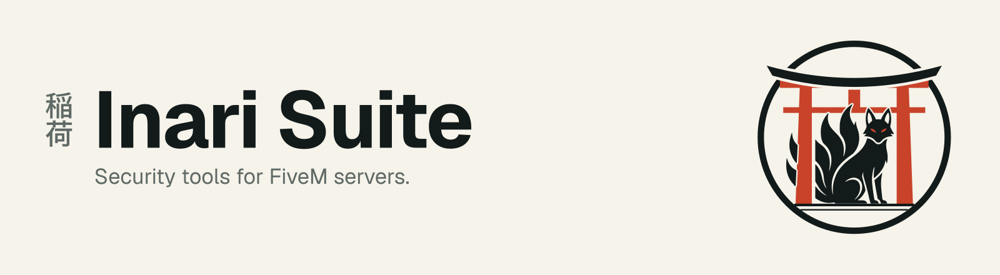

  <picture>
    <source media="(prefers-color-scheme: dark)" srcset="assets/banner-dark.svg">
    
  </picture>

This is the owner account of the **[Inari Suite organization](https://github.com/inari-suite-org)**. The code lives
there, starting with [torii](https://github.com/inari-suite-org/torii-fx), a runtime permission firewall for FiveM Lua
resources.
